# Prototype review: baking, eggs and the farm (1 Nov)

For Zafar, before the prototypes: your ChatGPT pictures beside how each game works, with your amendments applied. Your final notes here, then they're built in the lab on chai's rules (the onboarding, the language cards, the helper, counts tick at the number, everything from your chai feedback).

**Rules in every one** (yours): a count or amount ticks the moment it's reached and more taps don't land; only right-first-time rounds level up; a miss is funny, never a frown; voices are whatever Kutchi takes we have, else the device voice; Hannah Mami is a placeholder look; Snap ticks each right shot at once (an instant camera that prints).

---

## 1. The kitchen

### Eggs at breakfast

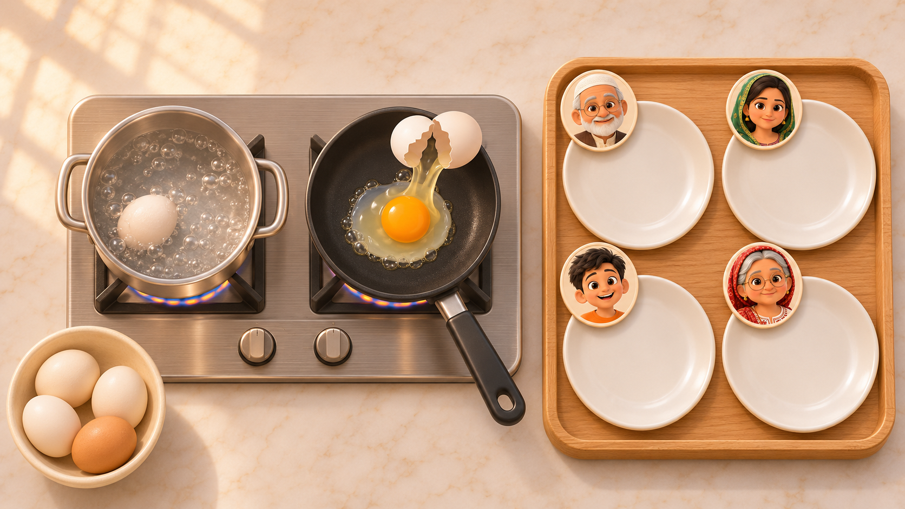
*The eggs station: the pot and the pan, the bowl of eggs, the tray with each person's plate*

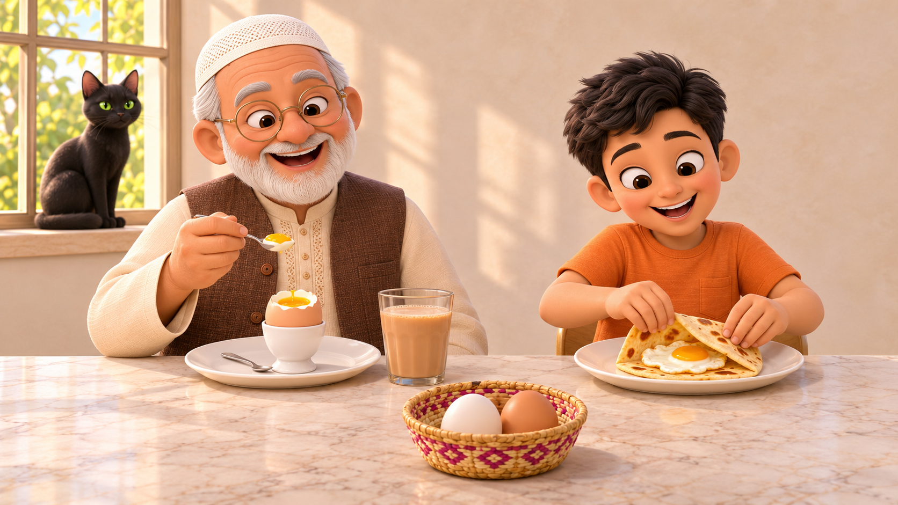
*Served: Nana's boiled egg in its egg cup, Ali's fried egg in a flatbread*

**What you're doing:** it's breakfast at Nani's, and each person at the table wants their egg boiled or fried.

**What you tap:**
1. An egg from the bowl, then the pot or the pan.
2. The egg when its ring is in the green, then that person's plate.
3. The tray, to carry the plates to the table.

**What you hear and what decides it:** "I want a boiled egg." The eggs all look the same, so only the cooking word picks the pot or the pan. Later, who it's for picks the plate.

**When it's done:** each plate ticks when it holds the right eggs, and the tray carries them over. Nana taps his boiled egg in its egg cup, "tok tok", and slices the top off. A plate with the wrong egg shakes and comes back.

**The fun bit:** the crack: one knock, the yolk slides out and wobbles, then the sizzle. And the spare egg, which Nani claims for herself.

**How it gets harder:**
- L1: one person, one egg; boil or fry.
- L2: two people, how many eggs, "with chilli" or "no chilli".
- L3: Nani passes on every order with no faces, so the name picks the plate.
- L4: soft or hard: "take it out now" or "leave it a bit longer".

**Words it teaches:** egg, boil, fry, crack, pot, frying pan, for Nana, breakfast.

### Baking (your design, 1 Nov)

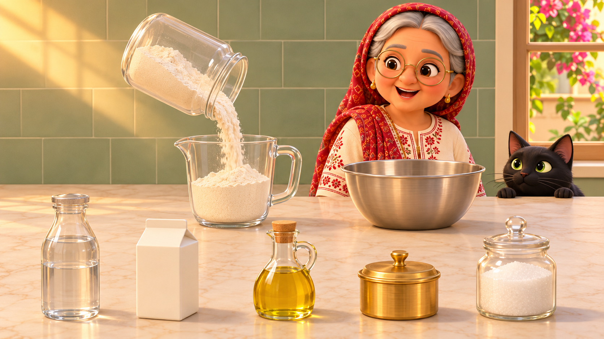
*The pour: Nani tips the flour*

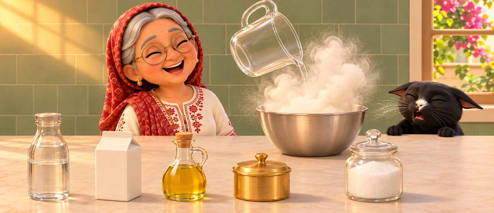
*A whole cup in with a puff, and Simba sneezes*

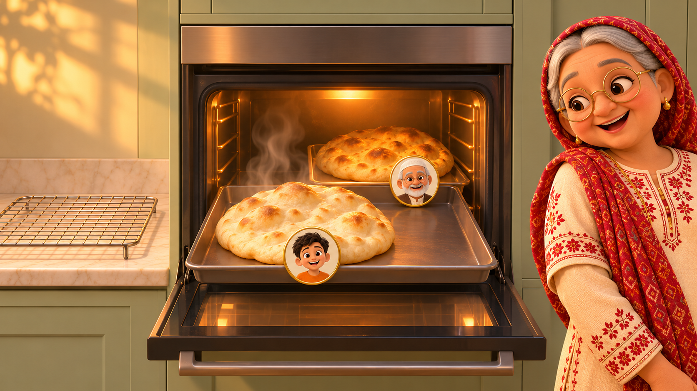
*The oven: the naan puffs up behind the glass*

**What you're doing:** baking dinner's naan or bread (or the party cake) with Nani, the way a grandmother teaches: one instruction at a time.

**What you tap (turn by turn, Zafar 1 Nov):**
1. The flour bag (or the water jug, the oil, the sugar) is held over the bowl. **Each tap tips it a bit more, and some goes in.**
2. Nani says one instruction: "put a little". You tap once; it's done, the bag won't tip more, and Nani speaks: "that's good".
3. "Put a lot": you tap, she's still waiting; you tap again, and again, until it's a lot; then she says "stop, that's enough". More taps don't land.
4. Teaching **"a little more"**: she says "put a little"; you tap once; she says "still a little more"; you tap once more; "that's enough".
5. "Half" and "a whole cup" the same way on the cup (L3-L4).
6. Tap the bowl to knead, then the oven: "take it out now" or "leave it a bit longer".

**What you hear and what decides it:** the amount words. There are no marks on the bowl or the bag; the taps and Nani's reaction carry the meaning, not a fixed measure ("a little" isn't "a quarter").

**When it's done:** each step ticks the moment the amount is reached; more doesn't go in. The naan comes out and Nana tears it: "aah". Nothing ever burns.

**The fun bit:** the bag's tip and the flour's puff; a whole cup of flour makes Simba sneeze; the naan bubbling up behind the glass.

**How it gets harder:**
- L1: "a little" or "a lot"; one bake.
- L2: "a little more" (two taps, two instructions); two bakes.
- L3: half and whole cups; whose bake comes out now.
- L4: two and a half; salt beside sugar; three bakes.

**Words it teaches:** a little, a lot, a little more, enough, stop, half, a whole cup, flour, water, knead, oven.

---

## 2. The farm (Hannah Mami)

### Feeding time

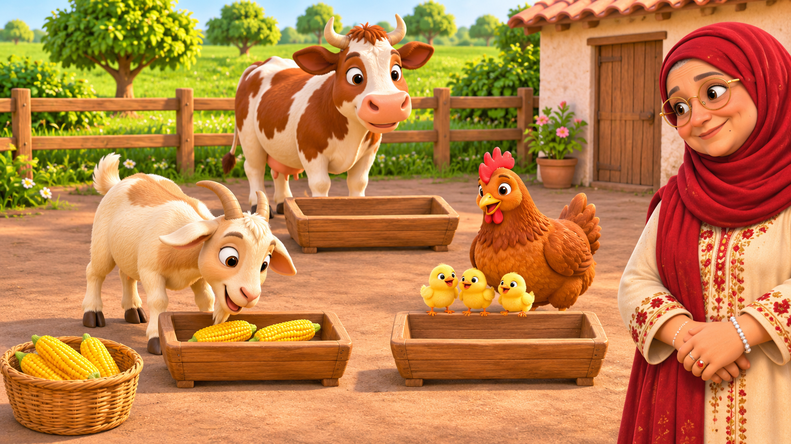
*Feeding time: the troughs, the goats, the hen and chicks, the cow*

**What you're doing:** the hen, the goat and the cow are hungry, and Nani says who wants what.

**What you tap:**
1. The corn basket: a cob lifts.
2. The trough of the animal named.

**What you hear and what decides it:** "The hen wants corn." Which animal, and from L2 how many cobs.

**When it's done:** the trough ticks the moment the right number of cobs is in, and another doesn't land. A wrong trough shakes and the cob hops back. At the end everyone eats at once.

**The fun bit:** the farmyard orchestra of munch, peck and moo; the chicks run in and steal a kernel; the goat sneaks into the hen's trough and gets its nose booped.

**How it gets harder:**
- L1: one cob each for two animals.
- L2: one to three cobs.
- L3: water and grass too: "the cow wants water".
- L4: a big goat and a small goat; counts to five.

**Words it teaches:** hen, goat, cow, corn, water, grass, wants, two, three, small.

### Collect the eggs

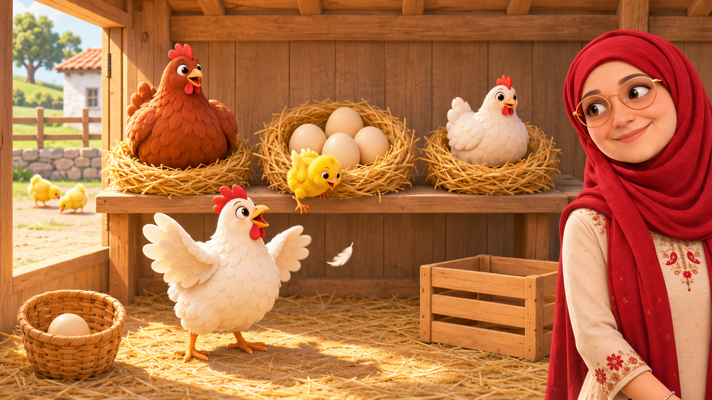
*The henhouse: lift a hen, find the eggs (and the chick)*

**What you're doing:** in the hen house, Nani asks for eggs from under one particular hen.

**What you tap:**
1. The hen named; she hops off her nest.
2. The eggs, into the basket.
3. Nani, to hand her the basket.

**What you hear and what decides it:** "An egg from under the big hen." Which hen (by size and colour), and from L2 how many. Peeking under any hen is free.

**When it's done:** the basket ticks at the number, and another egg doesn't land. Handing it over checks the hen: right, it ticks gold; wrong, the hen hops over and nudges her egg home, and Nani asks again. At the end Nani gives you one egg for Ali.

**The fun bit:** a chick hides under one hen every round and tumbles out cheeping onto her back.

**How it gets harder:**
- L1: two hens, big and small; one egg.
- L2: three hens; "the red hen", "two eggs".
- L3: "the red one"; "how many has the small hen got? Bring them all".
- L4: brown and white eggs: "two brown eggs from the big hen".

**Words it teaches:** egg, hen, big, small, red, white, brown, chick, two.

### The photo shoot

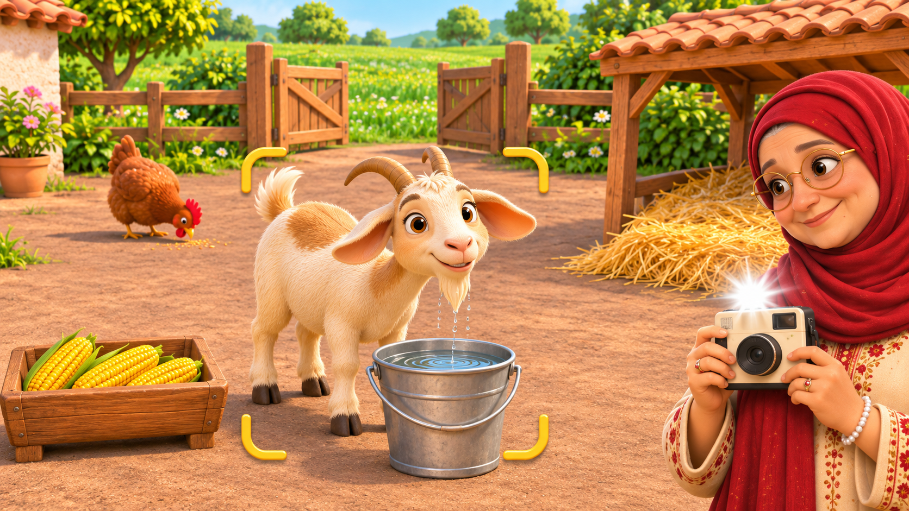
*The photo shoot: the goat in the viewfinder, the instant camera*

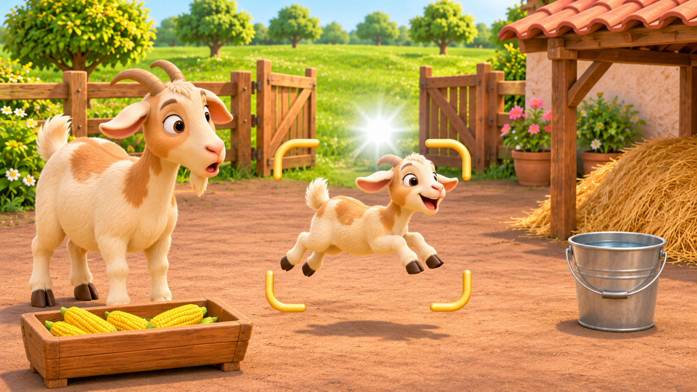
*A later level: the small goat leaping*

**What you're doing:** Nani has the camera, and you make the animal do what she says, then snap it.

**What you tap:**
1. The place (the trough, the gate, the bucket, the straw bed): the animal goes there and does it.
2. Inside the gold frame, to take the photo.

**What you hear and what decides it:** "Take a photo of the goat running." The doing word picks the place; later who and how many.

**When it's done:** the instant camera prints, and a right photo ticks straight away. A photo that doesn't fit gets Nani's laugh ("oh, the goat is sleeping!"), becomes a bonus picture, and she asks again.

**The fun bit:** the goat races through the gate, loops the field and lands in the frame with all four hooves in the air.

**How it gets harder:**
- L1: the goat eating or running.
- L2: the hen too; drinking and sleeping.
- L3: "two hens eating".
- L4: the big goat and the small goat.

**Words it teaches:** eat, run, drink, sleep, photo, goat, hen, two, small.

**Your amendment:** a tick on each right photo, straight away (no checking at the end).

### The corn stall

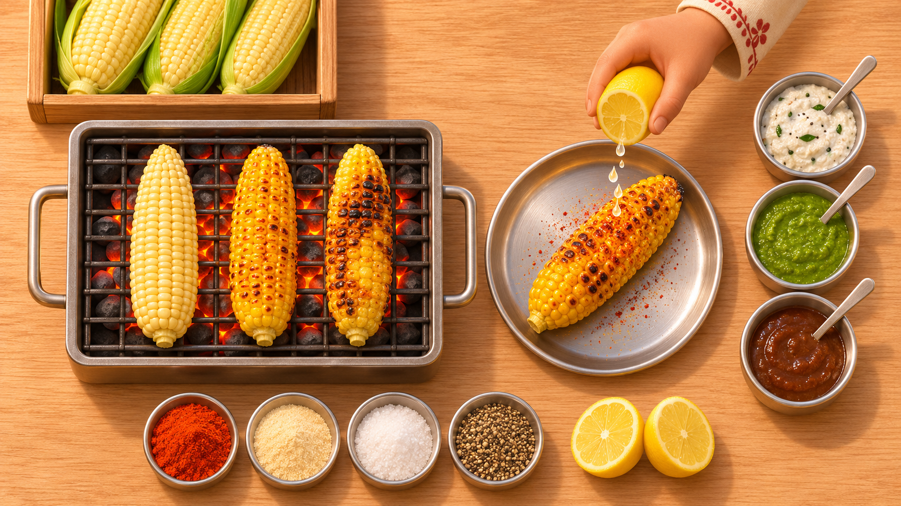
*The corn stall: roast, turn, dress, the chutneys*

**What you're doing:** at the farm's corn stall you grill corn and dress it the way each customer orders.

**What you tap:**
1. A cob onto the grill; tap it to turn when it's in the green, then lift it off.
2. The lemon or the chilli, then the chutney asked for.
3. Serve it.

**What you hear and what decides it:** "One corn with lemon and mint chutney." Which dressing and which chutney; later how many and "no chilli".

**When it's done:** the customer bites, "aah", and the row ticks.

**The fun bit:** the sizzle and the kernels browning; the squish of the lemon.

**How it gets harder:**
- L1: one cob; one dressing, one chutney.
- L2: three cobs; "two with lemon, one with chilli"; "no chilli".
- L3: the customer's own words: "make it spicy".
- L4: "a little chilli" or "lots"; garlic beside salt.

**Words it teaches:** corn, lemon, chilli, mint, chutney, salt, with, no, a little, lots.

### Home at dusk

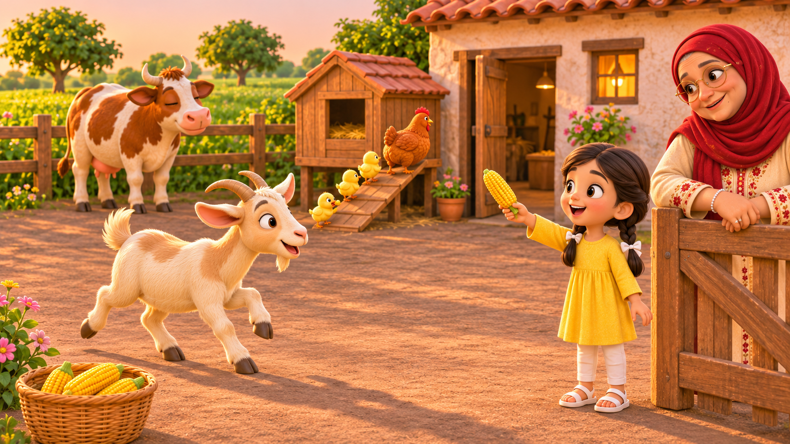
*Home at dusk: each animal to its place*

**What you're doing:** in the golden evening the animals go home, and at the end you call one over yourself.

**What you tap:**
1. The animal Nani says goes in now.
2. At your turn, Nani hands you a corn cob: say the animal's name and "come here" (or tap its picture).

**What you hear and what decides it:** "Now the cow goes into the shed." Which animal goes now; later "two hens go into the coop".

**When it's done:** each animal trots home and the shed window glows brighter. The one you call trots over, nuzzles the cob and goes in. If a different animal hears its name, that one comes instead.

**The fun bit:** the hen walks up her ramp with her chicks in a line, and the last chick runs back for a dropped kernel. A snore comes from the shed.

**How it gets harder:**
- L1: one ask (the goat or the cow); you call the last one.
- L2: three hens: "two hens go in now".
- L3: other ways of saying it.
- L4: the small goat: "the big goat first, then the small one".

**Words it teaches:** come here, go in, shed, coop, now, first, then, goodnight.

### Pick (second visit)

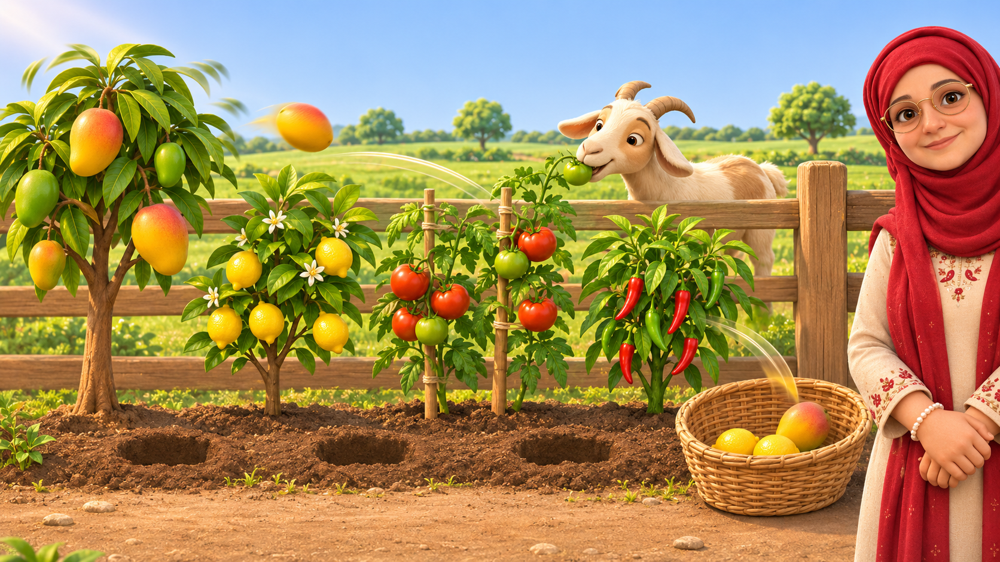
*Pick: N of each into the basket*

**What you're doing:** in the farm's kitchen garden, Nani asks you to pick fruit and vegetables into the basket.

**What you tap:**
1. A fruit: it pops off and bounces into the basket.
2. Nani, to hand her the basket.

**What you hear and what decides it:** "Pick two lemons." Which plant, how many, and later which colour or size.

**When it's done:** the basket ticks at the number. At the hand-over, a wrong one gets munched out of the basket by the goat over the fence, and Nani asks again.

**The fun bit:** the pop and the bounce, and the goat stretching over the fence to munch.

**How it gets harder:**
- L1: mango or lemon, one each.
- L2: tomatoes too; "two lemons".
- L3: colours: "the red tomatoes", "two green chillies".
- L4: "two mangoes and one lemon"; big or small mangoes; beans beside chillies.

**Words it teaches:** pick, mango, lemon, tomato, chilli, red, green, two.

### Plant and water (second visit)

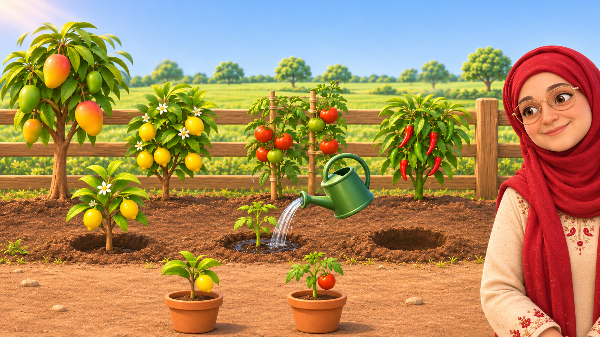
*Plant and water*

**What you're doing:** in the same garden, you plant the sapling Nani names and water it.

**What you tap:**
1. The sapling.
2. A gap in the soil.
3. Press and hold the watering can to pour.

**What you hear and what decides it:** "Plant the lemon." Which sapling, how many, and later how much water.

**When it's done:** the sapling shoots up into a little tree with fruit, and the row ticks. The water ticks when the amount said is poured; too little and it just droops until you pour more.

**The fun bit:** the grow, every time.

**How it gets harder:**
- L1: lemon or tomato; any amount of water.
- L2: chilli too; "plant two tomatoes".
- L3: "a little water" or "a whole can".
- L4: "one tomato and two chillies"; beans beside chilli.

**Words it teaches:** plant, water, a little, a whole can, lemon, tomato, chilli, grow.

---

