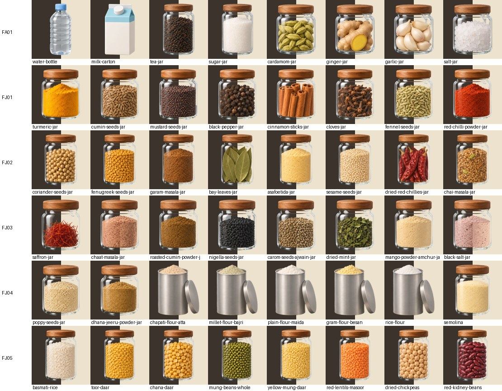

# The stove redo landed, and chai's shelf swapped to it (6 Nov)

Zafar's redo run of the stove pack (the 17 lines of `docs/design-language/art-plans/s17-stove400-redo-list.yaml`) landed as 17
raw sheets in `assets/ChatGPT 261106 2/`. This step mapped and cut them, judged every new cut, and, with FA01 passing, swapped
chai's shelf to the walnut set in one change, sized by the size classes. Nothing pushed or published.

**In plain words.** All 17 sheets arrived, one per line, nothing missing or doubled. **91 cuts replaced** in
`assets/cook/items-s17-stove/` (84 from the 11 walnut sheets, 7 named items from the 6 look sheets). **The walnut lids are one
family**: warm mid walnut, not dark (67 lids, median `#a0663f`). **FA01 passes**: one batch, one light, one lid, no labels.
**Chai's shelf is swapped** (water, milk, tea, sugar and every spice jar, cumin and mustard included, in one change) and **sized by
class**: at 740x320 the bottle and carton stand 50.3 CSS px, the tea and sugar jars 45.8, the spice jars 42.2 (none on the 40 floor).
**Two items still need a redo**: the frying bhajia (pink specks in its oil bubbles) and the dabeli (the bun still seen from the
front). The pills' rule stays green; the chai contract run had 0 breaks.

## Flaws first

1. **TF09 `t-bhajia-frying`: pink specks.** The pool of oil is gone, as asked, but ChatGPT drew small see-through oil bubbles round
   the fritters instead, and they took the magenta ground's pink at their rims. `artdespill.py` cleared the rim (28 px cleared,
   1,560 de-spilled) but the bubbles' pink sits deeper than its 3 px band and is the same hue as the red onion slivers, so no
   cut can take it out cleanly (a 12 px band and a hue pass both tried in scratch, no better). Visible as pink dots on the dark
   half at 420 px; at token size a faint pink fringe. **New redo line** (no bubbles, no oil).
2. **TD06 `t-dish-dabeli`: still a front view.** The plate is now round from above, but the bun shows its top dome, the filling at
   the cut and the lower bun's side: the same three-quarter look as v1. It reads well as dabeli; it does not match the sheet's
   top-down camera. **New redo line** (the top lifted off, filling facing up).
3. **TK02 `t-squeeze-bottle-chutney`**: now from above (round red nozzle cap, round shoulder), as asked, but the bottle is pale
   translucent plastic with no chutney showing; it reads as an empty squeeze bottle. Kept (the redo asked only for the view);
   worth a word to Zafar before the bottle is a word's picture.
4. **Three lids at the light end of walnut.** `artcolour.py`'s wood rule flags `f-cardamom-jar`, `f-dhana-jeeru-powder-jar` and
   `f-poppy-seeds-jar` as "light oak or pine": their lids measure L* 50-52, at the top of the house's walnut range and just inside
   the rule's light-wood band (L* 52-84). By eye they sit in the family (the contact sheets). Zafar asked for walnut "not too
   dark on the lids", and the bible's walnut (Vandyke Brown to Brown, L* 23-35) is darker than anything that landed: the rule and
   the brief disagree; worth one line from Zafar (decision 2).
5. **FA01 draws two jar sizes**: the tea and sugar jars stand 444 px, the four small spice jars 353 px (the v1 sheet drew all six
   the same). The size classes make it harmless on screen (each item is sized by its class, not its picture), and on a sheet that
   copies FA01 the jars of FJ01-FJ09 match the small ones. No redo.
6. **Two odd-ones-out on chai's shelf by the numbers, not by eye**: the cumin jar (FJ01) has more soft glass than FA01's jars (FJ01
   was cut with the gentler glass ramp of the other jar sheets, `soft_gain` 2, FA01 4); and the bottle and carton have their own
   caps (blue, white), as in v1. On the shelf shots they read as one batch.
7. **`f-dates` re-cut**: the first cut left dark dates behind soft glass (artcheck "dirt 5.7%"); re-cut solid with its empty glass
   top a hole (tol 16, `hole_min` 8), as the dark-seed jars were in the first landing. artcheck now: 0 new.
8. **The pill check's 1920x1080 L4 is timing-flaky**: its 30 s wait for the pills is close to the order's intro there (27 s, in
   the old tree and the new); one run in three found no pills. Not a layout fault (the same run's pills pass when they come);
   worth a longer wait in `pillcheck.mjs` (a fix-list row if it bites again).

## 1. The mapping

Matched by content against the cut spec's names in slot order. Raw sheets moved to `sources/art/s17-stove400/redo/` (off the site)
under the run spec's save names with `-v2`, `landed-mapping.csv` beside them.

| ChatGPT's name | now | line | kind | cut |
|---|---|---|---|---|
| Eight-Item Pantry Jar Grid | `fa01-chai-shelf-v2.png` | FA01 | walnut | all 8 |
| Eight Spice Jars Grid(2) | `fj01-jars-v2.png` | FJ01 | walnut | all 8 |
| Walnut-Lidded Spice Jar Collection | `fj02-jars-v2.png` | FJ02 | walnut | all 8 |
| Eight Glass Spice Jars Grid | `fj03-jars-v2.png` | FJ03 | walnut | all 8 |
| Stylized Kitchen Storage Container Collection | `fj04-jars-v2.png` | FJ04 | walnut + the atta tin open | all 8 |
| Eight Jars of Colorful Legumes | `fj05-jars-v2.png` | FJ05 | walnut | all 8 |
| Eight Pantry Jars Grid | `fj06-jars-v2.png` | FJ06 | walnut | all 8 |
| Eight Walnut-Lidded Ingredient Jars | `fj07-jars-v2.png` | FJ07 | walnut | all 8 |
| Pantry Jar Collection Grid | `fj08-jars-v2.png` | FJ08 | walnut + the baking powder tin open | all 8 |
| Artisanal Pickles and Pantry Jars | `fj09-jars-v2.png` | FJ09 | walnut | all 6 |
| Studio Still Life_ Dairy, Eggs, Bread, and Fish | `fp02-packs-v2.png` | FP02 | walnut (rose water cap) | all 6 |
| Cassava, Strawberry, and Egg Asset Sheet | `tf06-food-v2.png` | TF06 | look | `t-cassava-chips-golden` |
| Traditional Kitchen Objects Flat Lay | `tk02-kit-v2.png` | TK02 | look | `t-squeeze-bottle-chutney` |
| Nine-Plate Feast Flat Lay | `td03-dishes-v2.png` | TD03 | look | the two birthday cakes |
| Vibrant Corn, Naan, and Carrot Grid | `tf07-food-v2.png` | TF07 | look | `t-corn-kernels-in-a-cup` |
| Bhajia and Mandazi Cooking Progression | `tf09-food-v2.png` | TF09 | look | `t-bhajia-frying` |
| Indian Street Food Flat Lay Grid | `td06-dishes-v2.png` | TD06 | look | `t-dish-dabeli` |

FJ02 and FJ03 (both "spice jars") told apart by their contents (coriander, fenugreek, garam masala, bay against saffron, chaat
masala, roasted cumin, nigella). Confidence high on all 17.

## 2. The cut

`build/tools/art/specs/s17-stove400-redo.cut.json`: the 17 jobs of `s17-stove400.cut.json` with the same settings, `src` the `-v2`
sheets, names `null` for the items a look redo keeps from v1 (so only the named items are written); one change, the dates jar
(Flaws 7). Data to `sources/art/s17-stove400/redo/cut-data-redo.json`, merged into `assets/cook/items-s17-stove/cut-data.json`
(91 entries replaced, a `_redo` note). `artdespill.py` on the three magenta cuts. 17 jobs, 0 flags; every cell had its item.

## 3. The judge

- **Sheets** (`artjudge.py --no-look`, the v2 sheets under their v1 save names in a scratch folder): 17 sheets, **14 pass, 3 flag,
  0 fail**. Flags: TD03 and TD06 tight margins and round plates "may read as sweets" (the dish sheets' usual); TF07 one round
  disc (the corn cup from above).
- **Cuts** (`artcolour.py`, one batch per sheet, the re-tuned tool): 91 cuts, **66 pass, 25 flag, 0 fail**. No baked shadow, no
  halo, no off-palette colour, no wrong light anywhere. The flags: the three light-walnut lids (Flaws 4); "camera height" spreads
  on FA01, FJ01, FJ02, FJ03 that are the contents' tops, not the jars; the steel tins against the glass jars (FJ04, FJ08, FJ09:
  soft alpha, lid colour); the bottle, carton and cream against the jars (caps, edge whiteness); the mango and lime pickles' strong
  colour off the house palette.
- **All 84 walnut cuts as one batch**: 73 pass, 11 flag (the same items), one lid family by the tool.
- **The lids, my measure** (the warm pixels of each jar's top band): 67 lids, median `#a0663f` (L* 49), each within ΔE00 5.3 of
  FA01's median except `f-vermicelli` (9.9: the lid's shaded band, same lid by eye); ΔE 20-28 from the old pale oak `#e7aa6b`,
  15-22 from the dark walnut `#5d432c`: **mid walnut, warm, not dark**, as asked.
- **Pixel check** (`artcheck.mjs`): 471 findings, 471 known, **0 new**.
- **By eye**: every cut on a split dark and light ground (`build/reports/art/stove-redo-landed-2026-11-06-jars-a.jpg`, `-jars-b.jpg`)
  and each look redo old beside new (`-look.jpg`). The jar sheets look like one shoot: the same jar, glass, highlight and lid
  on all ten sheets; no text or labels; the FJ04 atta and FJ08 baking powder tins now open with their flour and powder showing.
  Look redos: **kept** TF06 (thick golden mogo chips), TD03 (both cakes from above, the top a circle), TF07 (kernels in an opaque
  white cup, no pink), TK02 (from above; Flaws 3); **redo again** TF09 and TD06 (Flaws 1-2).

## 4. FA01, judged hardest: passes

- **One batch**: the six jars one jar (body, shoulder, glass, highlight, lid), only the contents and two heights change; the bottle
  and carton share the camera and light.
- **One light**: from the upper left on all eight (the highlight on each jar's left shoulder); no shadow, nothing behind.
- **One lid family**: six walnut screw lids, `#925a37` to `#ac6c42` warm pixels, within ΔE00 4.7 of their median; the nine jar
  sheets copy it (above).
- **Contents read**: tea leaves, sugar, cardamom pods, ginger root, garlic cloves, salt crystals (coarse, apart from the fine sugar).
- No labels, no text.

**Verdict: FA01 passes; the swap went ahead.**

## 5. The swap (ART-50)

One change (commit 8d2d36b): `data/cook.json` `art.chaiShelf` names chai's shelf pictures, read first by `chai-tray.js` `spiceJar`
and by the order's word cards while chai is up (`ui.js` `s02Jar`), so the card still shows exactly what the shelf draws.

| word | shelf picture now | was |
|---|---|---|
| `cook-paani` (paani) | `f-water-bottle` (FA01) | `shelf-cook-paani-bare-f` |
| `cook-dudh` (dudh) | `f-milk-carton` (FA01) | `shelf-cook-dudh-bare-f` |
| `cook-chai` (chai) | `f-tea-jar` (FA01) | `shelf-cook-chai-bare-f` |
| `cook-khun` (khun) | `f-sugar-jar` (FA01) | `shelf-cook-khun-bare-f` |
| `spi-10` (elchi) | `f-cardamom-jar` (FA01) | `shelf-elchi-jar-v2-f` (s02 C5) |
| `veg-14` (aadu) | `f-ginger-jar` (FA01) | `shelf-aadu-jar-v2-f` (s02 C5) |
| `veg-13` (lasan) | `f-garlic-jar` (FA01) | `shelf-lasan-jar-v2-f` (s02 C5) |
| `spi-16` (loon) | `f-salt-jar` (FA01) | `shelf-loon-jar-v2-f` (s02 C5) |
| `spi-02` (jeeru) | `f-cumin-seeds-jar` (FJ01) | `shelf-spi-02-bare-f` |
| `spi-05` (rai) | `f-mustard-seeds-jar` (FJ01) | `shelf-spi-05-bare-f` |

**My call, beyond the brief's eight:** chai's shelf also puts out cumin and mustard as tea decoys (`teaDecoys`, L1-L4 by the seed);
left on the old pictures they would have put a second lid family back on the shelf, so they take FJ01's walnut jars (the sheet that
copies FA01). The old files all stay in the repo: the pantry-v2 bare jars are still used by baking, daar, the pantry and the clinic
prototype; the s02 C5 jars by the pantry (`fetch`); none is deleted. `look-rules.json`'s named batch `chai-shelf` now lists the ten
new pictures.

## 6. The size classes on chai's shelf (ART-51)

`St.classFit(S, key, id, { base, ppw, slotW })` in `js/cook/station-lib.js` (with `St.sizeClass`, `St.CLASS_K`, `St.FLOOR_CSS`):
the class from `words[id].size`, else `art.sizes[id].size`, missing = M; the L height is the band's room with the hop kept (as the
old `shelfFit`), M and S 0.91 and 0.84 of it; LONG on the picture's long side, W by the slot's width; never under 40 CSS px (then
`floored`), never wider than the slot (then `capped`). Chai's per-group `SHELF_K` is gone. `Cook.chaiShelfSizes()` reads each
item's class and opaque height on screen.

| item | class | 740x320 | 930x430 | 1280x665 | 1920x1080 |
|---|---|---|---|---|---|
| water bottle, milk carton | L | 50.3 | 68.8 | 91.1 | 147.3 |
| tea jar, sugar jar | M | 45.8 | 62.6 | 82.9 | 134.0 |
| elchi, aadu, lasan, loon, jeeru, rai | S | 42.2 | 57.8 | 76.6 | 123.7 |
| before: every item | (none) | 49-50 | 67-69 | 89-91 | 143-147 |

CSS px of the opaque picture, at every level (the same at L1-L4). M / L = 0.910, S / L = 0.839. **None floored, none capped** at
any size or level (the widest picture 37.6 CSS px in a 47.7 px slot at 740x320 L4). Before, the old `shelfFit` capped every group
at the band's room, so `SHELF_K` did nothing and every item stood the same height; the steps are new. The pills: unchanged
(`pillcheck.mjs`: all 20 pass; the layout code is untouched, and at 1920x1080 L4 the closest gap is 28.9 px in both trees).

## 7. Still to redo

`docs/design-language/art-plans/s17-stove400-redo-list.yaml` now holds round 2: **TF09** (the frying bhajia, no bubbles) and
**TD06** (the dabeli from above). `artblock.py --redo` builds the block: 2 lines. Not lines but worth Zafar's eye: the empty-looking
squeeze bottle (Flaws 3); the tool handles still in light wood (TK02's daar churner, TK03, TK05, TB05: walnut on their next redo,
ART-53).

## Decisions for Zafar ("yes to all except …")

1. **Keep the shelf swap** (walnut set, one batch, sized L / M / S). Recommend: **yes**; then the old two-batch pictures can be
   retired from chai's history (they stay for the other stations).
2. **Lids at L* 44-52 are "walnut"** for the wood rule (the art bible's walnut is darker, L* 23-35, and the tool flags three lids as
   oak). Recommend: **yes, widen the rule's walnut to mid walnut** (your "not too dark on the lids"), so the three flags go.
3. **The round-2 redo** (TF09, TD06: two images). Recommend: **yes**, in the next art run, not one of its own.

## Proof

- Cut: `python3 build/tools/art/artcut.py build/tools/art/specs/s17-stove400-redo.cut.json`: "17 job(s); 0 flag(s)"; then
  `artdespill.py` on `t-cassava-chips-golden`, `t-corn-kernels-in-a-cup`, `t-bhajia-frying`; merged into `cut-data.json` (91).
- Sheets: `artjudge.py --spec build/tools/art/specs/s17-stove400.run.yaml --dir <scratch: v2 under v1 names> --no-look`:
  "17 image(s): 14 pass, 3 flag, 0 fail".
- Cuts: `artcolour.py <one sheet's new cuts> --batch <line> --batch-by none` per sheet: 66 pass, 25 flag, 0 fail; the 84 walnut
  cuts as one batch: 73 pass, 11 flag, 0 fail; chai's ten as `--batch chai-shelf`: 5 pass, 5 flag, 0 fail.
- Pixels: `node build/tools/art/artcheck.mjs`: "471 findings ... 471 known, 0 new".
- Shelf: `node build/tools/review/shelfshot.mjs` on the old tree (commit 586e972 copied to scratch, `--root`) and on the new,
  `python3 build/tools/review/shelfsheet.py`: `build/screenshots/shelf-swap/lab-740x320-L4.png` (the lab shot first) and
  `sheet-740x320.png`, `sheet-930x430.png`, `sheet-1280x665.png`, `sheet-1920x1080.png` (L1-L4, BEFORE above AFTER).
- Judge batch: `build/screenshots/shelf-swap/judge/brief-01.md` (ART-50, ART-51, ART-53), for the orchestrator's judge.
- Pills: `node build/tools/review/pillcheck.mjs`: 20 of 20 pass (1920x1080 L4 on a second run; Flaws 8).
- Contract: `COOK_TEST_PORT=8861 ... node build/sandbox/run.mjs --touched cook:chai-tray,lab:cook/chai-tray --parallel 3
  --budget-min 20 --check` (run 20261106-1733, resumed once): CONTRACT_RESULT.
- `node build/tools/review/checks.mjs`: CHECKS_RESULT.
- Rows: ART-50, ART-51, ART-53 to **to fix: check** (built; the judge and Zafar's eye to come), ART-52 **to fix: code** (chai's
  shelf built; daar, the pantry, the clinic and `sizecheck.mjs` to do).
