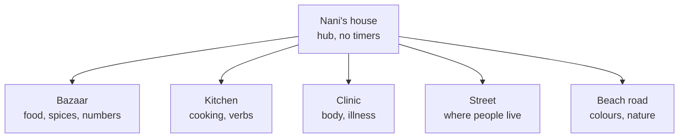

# Story and arcs

The story spine for every mode: Nani's role, how the story is told, the arcs, and the syllabus that decides which language each stage teaches. Modes' own story homes live in their files in `docs/game-design/modes/`; scoring and unlocks are in `progression-and-scoring.md`.

## Part 1. Story structure (Roadmap and Story Structure)

**Story mode is "A day at Nani's" (Zafar, 19 Oct):** the days, their stages, the people and the trips are designed in `docs/game-design/days/` (README.md and one file per trip). The retired arcs (the Birthday, the day-out template, the standalone arcs, Eid) are in `docs/archive/game-design/story-arcs-retired.md`; the standalone arcs are future day ideas there.

> from: docs/archive/design-v1/Roadmap and Story Structure.md § Nani's role

### Nani's role

**Nani is the child's guide**, not a character confined to her kitchen (decided 28 Sept 2026). She helps the child learn, grow and explore, and she appears everywhere: cooking, travelling, the clinic, the sewing room, and the fire at the end of every arc. The kitchen is still home base and still teaches the most words, but it's her house, not her cage.

> from: docs/archive/design-v1/Roadmap and Story Structure.md § Story structure: the levels of granularity

### Story structure: the levels of granularity

| Level | What it is | Example | Progress object |
|---|---|---|---|
| **Story** (arc) | A whole season with a finale | *The Birthday*: guests arrive, food is cooked, the table is set, the sweets are found and packed, the candles are blown out | Finishing it puts its book on the bookshelf (decision 4) |
| **Chapter** | One event in the story with its own goal, complication and payoff | *The guests are coming*, then *The cat and the sweets* | One chapter of the arc's book |
| **Errand** | One play session, 5–8 minutes. This is "the level" | *Cook each guest's order*, *Set the table*, *Find the sweets* | Words mastered go into their container |
| **Game mode** | A reusable mechanic that errands are built from | Shopping, put-it-there, hide and seek, cook-along, at-the-door, ask-around, spot-it, body/dress | None of its own, see Game modes below |
| **Container** | A long-running collection that fills as words are mastered | Nani's pantry (food), the spice cupboard, the sewing kit (colours/threads), the wardrobe (clothes) | Is the progress |

**Two kinds of progress, deliberately split:** containers track **words** (a mastered word stays on the shelf for good), the bookshelf tracks **story** (one named book per finished arc; each book opens to its chapters).

**Learning tree:** each domain has its own levels (Kitchen 1–5, Sewing 1–5, Wardrobe 1–5, Family 1–5), driven by the per-word stages of the words in it. Long term: the player composes their own recipe from ingredients they know, and later says what they like to eat.

**Storytelling principles:** alternate pace (calm kitchen, busy bazaar, curiosity, mild tension); every chapter has a goal, a complication and a payoff; each chapter opens a place and fills a container; recurring characters carried across every arc; events cause the next errand rather than errands being handed out; **consecutive errands never repeat the same main action**, so each one feels like a new thing to do.

**Cost to keep in mind:** each story event needs a background, characters, and recorded sentences. The family's recording time is the real limit on pace, so the story reuses places and characters heavily.

> from: docs/archive/design-v1/Roadmap and Story Structure.md § How the story is told

### How the story is told

Many players can't read, and the Brief rules out cutscenes, so the story is carried by **what you see and hear, never by text you must read.** Understanding the story is a bonus; the task itself never depends on it.

#### Three channels, in order of importance

| Channel | What it carries | Who it reaches |
| --- | --- | --- |
| **Picture and action** | What changes in the world: a lantern goes up, the empty bowl on the island, the pot on the stove, the guests' shoes piling up by the door. Nani points and gestures | Everyone, including a four-year-old |
| **Sound** | Nani's voice in Kutchi, a knock at the door, a bubbling pot, market chatter | Everyone; the Kutchi is the teaching |
| **Text** | The Kutchi line, written and underlined as it is spoken. Written English is for grown-ups only, in the "?" pop-up (E1) | Readers, and the adult sitting with a child |

#### Story beats

Each errand opens and closes with a **beat**: 3 to 5 seconds, one visual moment, one Kutchi line from Nani (spoken English first in story mode where a longer idea needs it, G15). Skippable with a tap, skipped automatically on replay. It's a moment inside the scene, not a cutscene: the player is already in the kitchen, and Nani does something.

Story lines are recorded like any other sentence. Until the family has given the Kutchi, the line is a grey-italic English placeholder flagged "to record", with no audio. Never invented Kutchi (G2).

#### The hub fills up with the story

The kitchen is the hub, and it **changes as the story moves**: decorations build up errand by errand (for the Birthday: balloons, then streamers, then the laid table, then the cake), and the same idea carries into every later arc (a day out leaves a souvenir on the shelf; the clinic arc adds a certificate; a day's sewing adds a finished garment to the wardrobe). A returning player sees at a glance where they are in the story without reading anything. This is the cozy-game principle: progress shows up as a changed place.

### Syllabus

#### Grammar forced by Kutchi itself

1. **Every noun has a gender, and other words agree with it.** Gender and plural are fields on the Word entity, filled in by the family with the word itself.
2. **Positions come after the noun**, as in Hindi, Gujarati and Sindhi. Each hotspot's place phrase is one self-contained recording.
3. **The past tense is the hardest part.** In transitive perfective sentences verb agreement can go partly missing, and with a first-person singular subject the verb may agree with the object. So intransitive past tense comes before transitive.

Worth checking with the family: in the closely related Kutchi Gujarati, "like" and "have to" take a "to me" subject. The frame *Muke … khape* looks like the same pattern, so "I need / I like / I have to" are taught as fixed chunks from the first session.

#### Sizing it

Cambridge's Pre A1 Starters expects over 500 words and A1 Movers adds roughly 400 more. For a home language the target is **roughly 400 words plus about 40 sentence frames**.

#### Six stages (internal, never shown to players)

| Stage | Can-do | Grammar and frames | Vocabulary domains | ~New words | Carried by |
| --- | --- | --- | --- | --- | --- |
| S1 Arrive and fetch | Greet, understand a request, count what's asked for | Greetings; "I need X"; "give me X"; number + noun; yes/no | Greetings, numbers 1–10, fruit, veg, spices, staples | 60 (first release) | Arc 1: The Birthday |
| S2 Do as Nani says | Follow two-part commands, put things in places | Imperatives; position phrases; this/that | Rooms, household objects, utensils, clothes (nouns), colours, sweets and dishes | 80 | Arc 1: The Birthday, then the early day-out trips |
| S3 Who's who | Name family, ask simple questions, say likes | Possessives; who/what/where/how many; "I like" chunk; adjective agreement | Kinship, people and jobs, jewellery, sizes and shapes, basic adjectives | 70 | TBC: likely Making clothes with Big Ma and/or the clinic arc |
| S4 How I feel | Say what hurts and how you feel | Present and habitual; "it hurts"; "I'm cold"; "it's raining" | Body, health, feelings, weather, times of day, farm animals and birds | 70 | TBC: likely Volunteering at the clinic |
| S5 What happened | Follow and retell a simple event | Past tense, intransitive then transitive; yesterday/today; first/then | Actions, materials, household (extended), place words | 60 | TBC: a later day-out trip |
| S6 Tell and plan | Describe people, compare, say what will happen | Future; comparatives; "because"; short narrative | Nature, travel, places, describing people, cultural and religious life | 60 | TBC: a later day-out trip, or Eid |

**This mapping is provisional** (28 Sept 2026 rework): the old plan fixed one arc per stage; the new plan fixes the *trip template* and lets each trip's vocabulary and grammar load settle as it's actually built. Revisit this table once two or three trips exist.

Two strands run through every stage: **numbers** (1–10 in S1, larger with prices from Arc 2) and **respect language** (formal and familiar "you", honorific kinship titles).

Chapter 1's restructure pulls a little S2 forward (the dastarkhwan's position phrases and tableware nouns). That's fine: they are heard in context and only need recognising, not producing.

#### Gaps and fixes

| Gap | Fix |
| --- | --- |
| Times of day and days | TBC which trip opens with Nani's day: morning chai, midday, evening lamps |
| Money | A future trip's food stall or shop, adding coins to the quantity mechanic |
| Jobs and people | The safari and boat trips bring in the driver, the guide, the boatman |
| ~150 to 200 story-carried words against a ~400 target | Generated side errands (Nani's everyday requests) carry the long tail; adaptive pacing lets faster players clear it sooner |

## Part 2. The world (Game Design)

> from: docs/archive/design-v1/Game Design.md § The world

### The world

Hub and spokes. Nani's house is the hub and it is always calm: no timers, no failure, nobody hurrying you. Everything outside it is a spoke holding one area of vocabulary.

**How it opens.** One spoke at a time, unlocked by the errand that needs it. The map is never a wall of locked doors, because a place you cannot go to simply is not drawn yet. The world grows rather than unlocking.

**Semi-open, not open.** Once a place is known you can walk back to it whenever you like and buy things with pocket money, or take on a small side errand. But there is always one lit path: whatever Nani wants today. A child who does not want to choose never has to, and an adult who wants to wander can.

**Travel is two taps.** No minigame between locations. That is the shortest route to bloat.

**People live here.** The relatives from the family unit are not a vocabulary list, they are residents. Masi is at the beach road, Mama runs a stall, Fui is next door. This is what makes the blanket quest work, and it means kinship words are learned by visiting people rather than by tapping faces on a chart.

> from: docs/archive/design-v1/Game Design.md § Scene catalogue

### Scene catalogue

The teacher's Unit 1 to 9 sequence is already a curriculum built by someone who teaches this for a living. It is used as the spine, with a game mode against each unit.

| Unit | Vocabulary | Scene | Mechanic |
| --- | --- | --- | --- |
| 1 | Numbers | Woven through everything | Quantities at every stall |
| 2 | Greetings, how are you | The doorstep | Who is knocking, and how you answer |
| 3 | Family, jobs | The street | Visiting relatives, who does what |
| 4 | Actions | Charades in the yard | Tap the person doing what she says |
| 5 | Body, illness | The clinic | Find out what hurts, fetch the medicine |
| 6 | Food, drink, meals | **Bazaar** and kitchen | Shopping list, then cooking |
| 7 | Prepositions, where you live | Hide and seek | Put the cat behind the door, on the roof |
| 8 | Journey, colours, nature | Beach road | Spot what she names as it goes past |
| 9 | Getting ready, visiting | Pack the bag | Timed hunt for socks, shoes, sweets |

Two scenes deserve spelling out.

**The bazaar** is the first build. Nani names what is missing, the pantry turns it into a list, you go to the stall, the seller asks what you want and how many, and you come home and hand each thing over. It teaches food, numbers and the shape of a transaction, and it is the template every other scene is a variation on.

**The blanket quest** is the second build, and it is the most complete idea in the design. It is now Big Ma's quilt-making arc (decision 4); the last step ends in a book on the bookshelf, not a patch.

1. Nani is making a quilt and needs coloured thread. She does not know which colours.
2. You go round the family asking each person their favourite colour. Masi, Mama, Fui, Dada. Each answers in Kutchi and shows you the colour.
3. Each answer writes itself into your notebook, next to that person's face.
4. You take the notebook to the bazaar and buy the threads, which means reading back what you wrote.
5. You bring them home and Nani asks for each colour in turn. You pick from your basket.
6. The finished quilt becomes a chapter of the arc's book.

One quest, and it carries kinship terms, colours, asking a question, reading back, and a recall drill at the end. The reward is an object that stays on the wall, made of the colours the player's own relatives chose. It is worth building early because it proves the whole design: teaching by doing, spaced repetition disguised as a task, and progress you can see.

## Part 3. The syllabus-first table (game-modes-v2)

> from: docs/archive/design-v1/game-modes-v2.md § §1 What the syllabus demands

### 1. What the syllabus demands

| Stage | Language to teach | Kind of game that *forces* that language |
|---|---|---|
| **S1 Arrive and fetch** | Greetings, "I need X", "give me X", number + noun, yes/no; fruit, veg, spices, staples | Fulfilling requests; finding named things; counting out |
| **S2 Do as Nani says** | Imperatives, **position phrases**, this/that; rooms, household objects, utensils, clothes, **colours**, dishes | Following commands with verbs; placing things *where* told; picking by colour |
| **S3 Who's who** | Kinship, possessives, **who/what/where/how many**, "I like", **adjective agreement** | Serving the right person their preference; identifying people from descriptions; dressing to a description |
| **S4 How I feel** | Present and habitual, "it hurts", "I'm cold", weather; body, feelings, times of day, animals | Treating patients; reacting to the weather; routines by time of day; animals |
| **S5 What happened** | **Past tense**, yesterday/today, **first/then**; actions, materials, place words | Solving "who did it"; ordering events; following recipe sequences |
| **S6 Tell and plan** | **Future**, **comparatives**, "because", describing people, nature, travel | Packing with size and weight rules; spotting and describing; planning |
| **Running through everything** | Numbers (larger from Arc 2, with prices), respect language (formal "you", honorific kinship) | Money in every shop and upgrade; greeting each character correctly |

---

## Zafar's answers, 14 Oct

- **Arc 1's hide-and-seek beat** (the cat scatters the mithai; find the sweets) is Find it's **Simba's mischief** round (4d), not a Who did it? case. (Zafar, 14 Oct)
